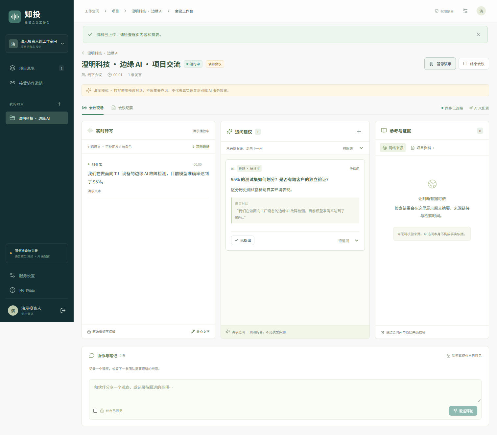

# 知投 · VC Meeting Assistant

会前上传 BP；会中本地实时转写，DeepSeek 生成有原话依据的追问并查询公开技术资料；会后整理、发布和导出纪要。

主交付为 Apple Silicon（M 系列）Mac 测试包，要求 macOS 14.2 或以上。中英文流式模型已内置，无需语音云服务密钥或首次下载。应用只需配置 DeepSeek API 才能启用智能分析，未配置时本地转写仍可用。

**[下载 Mac 测试版 v0.1.0](https://github.com/Zane38775/vc-meeting-assistant/releases/tag/v0.1.0)** · [安装说明](docs/START-MAC.md) · [Mac 开发与验收](docs/MAC-DEVELOPMENT.md) · [验证记录](VALIDATION.md)

公开下载为 Release 附件 `VC-Meeting-Assistant-0.1.0-mac-arm64.zip`，内含应用、模型和安装脚本。GitHub 的 `Source code (zip)` 用于源码开发。当前源码版本为 `0.1.2-beta.3`，是尚未发布的本地候选版。两版均为测试构建，尚未做 Apple Developer ID 签名或公证。



上图是明确标记的演示流程，使用预设对话，不代表真实识别或 DeepSeek 输出。

## 给使用者

1. 解压 Mac ZIP。按包中的《开始使用》执行 `Install-on-Mac.command`，它安装到当前用户的 Applications 并创建本机临时签名。v0.1.0 在一台 Mac 上遇到 Finder 扩展属性导致的签名失败，使用修订脚本完成了安装。修订已纳入本地候选版。
2. 打开 VC Meeting Assistant，创建本机账号。在「服务设置」输入 DeepSeek 密钥。只有该服务首个注册账号可修改配置。密钥不会回显。
3. 新建项目，上传 PDF、PPTX、TXT 或 MD，核对提取页码和摘要。配置密钥后，上传会尝试自动生成摘要、术语和项目级会前研判。
4. 创建真实会议，选择线下或线上；点击「开始采集」后才请求音频权限。线上模式需要麦克风与系统音频权限，并可能请求屏幕捕获权限以选择音源。不保存屏幕画面。
5. 暂定字幕会持续修订，AI 追问依据已定稿发言。追问和资料搜集与字幕并行。暂停或结束会等待尾句处理，缺失时显示缺口。
6. 会后生成纪要，检查并发布或导出 Markdown。演示会议始终标记为演示，不会开启麦克风或调用真实分析服务。

默认不保存原始录音；转写、材料、笔记和配置存放在本机用户应用数据目录。后台默认只监听 127.0.0.1，单机包的邀请链接不能直接供异地伙伴访问。异地使用需部署共享服务；目前可直接导出纪要分享。

## 本地候选版改动

- 原生语音引擎在独立子进程运行，初始化取消或引擎崩溃不再与会议服务共享进程。开始/恢复时等待本次模型就绪后才发送音频；授权和加载阶段可取消。该路径已通过故障回归，真人闪退复验仍待完成。

- 默认改用本地 X-ASR 480 ms 流式模型，保留 Zipformer Small 显式回退。短样例英文有所改善，但 `ACE-Step` 等专名仍有误识，新模型真人效果尚未验收。[模型对比](docs/ASR-MODEL-EVALUATION-2026-11-17.md)
- 会前研判按项目汇总公司、产品、客户、技术路线、商业模式、关键指标和融资需求，分别展示资料页引文、AI 假设、证据缺口及最多五个优先追问。研判参与会中分析，资料修改后需重新生成；资料或研判在生成问题期间改变时，旧草案不会发布。

- 材料上限提高到 100 MiB，保留页数和 PPTX 解压限制。修复 Mac 打包服务中的 PDF 解析、保存长页文字和追问跳转到错误材料的问题。
- 配置 DeepSeek 后，上传 BP 会同时尝试提取带页码和逐字引文的英文术语。旧材料可点击「提取术语」，也可在「服务设置」手工补充。术语仅作为同项目下次开始或恢复采集时的本地解码提示。
- 会中积累 80 个新增有效字符再安排分析，两轮实时分析至少相隔 30 秒。每轮最多展示一个有新增发言依据的追问，允许零问。暂停或结束后有新尾段时可补一轮。
- 公开检索保留来源、时间和原文摘要，并仅依据搜索摘要生成有逐字引文的中文要点、相关性和待核实事项。后续追问可参考同一场会议已整理的资料。

## 已验证与未验证

- **当前验收阻断**：0.1.2-beta.2 真人收音开始约 5.2 秒后闪退。0.1.2-beta.3 已加入进程隔离和就绪握手，本机 124 项测试通过、零跳过；真人中英文与暂停/结束尾句仍未验收通过。[闪退记录](docs/ASR-STARTUP-INCIDENT-2026-11-18.md)

- v0.1.0 在 Apple Silicon Mac 上完成修订脚本安装、本机签名、启动、真人线下收音和真实 DeepSeek 追问与检索。测试暴露了英文错词、重复浅显的追问、PDF 解析错误和大 PPTX 上传上限。
- Mac 上的阶段性自动测试和生产构建已通过。真实 Electron 服务中合成 PDF 已解析并通过原件字节比对。源码界面重新上传原约 35.2 MB PPTX 后成功解析 50 页，摘要曾因 DeepSeek 返回条数超过本地限制而未显示。修订后实际接口已生成摘要和有原文依据的术语，0.1.1 候选界面已提取摘要和术语，但真人复验仍把 `home party` 识别成「红 PARTY」，将 `ACE-Step` 识别成「A STEP」，并有一句尾句缺失、原因未确认。
- 待验证项目包括X-ASR 新候选版的真人中英文识别、追问深度、中文资料质量、腾讯会议双向收音、60 分钟稳定性和异地双设备协作。[本地 ASR 验证](docs/LOCAL-ASR-VALIDATION.md) · [验证记录](VALIDATION.md) · [Mac 设备记录](docs/MAC-DEVICE-VALIDATION-2026-11-16.md)

当前限制：本地模型不自动区分说话人，支持人工修改角色；扫描页和图表不做 OCR，显示解析警告并允许补录；公开检索使用保守技术关键词表，超出词表的查询不发送；没有 AI 投资评级功能。

## 源码运行

要求 Node.js 24、npm；Windows/macOS。模型下载的两个源归档合计约 565 MiB，运行模型合计约 219 MiB（X-ASR 约 161 MiB，加旧模型约 57 MiB）；下载脚本校验固定 SHA256。

```text
git clone https://github.com/Zane38775/vc-meeting-assistant.git
cd vc-meeting-assistant
npm ci
npm run model:download
npm run build
npm run desktop
```

网页开发可运行 `npm run dev`；生产网页服务为 `npm start`。首次设置可以在应用内完成，也可以把 `.env.example` 复制为 `.env`。不要提交或分享 `.env`。

```text
npm test
npm run typecheck
npm run package:mac
python3 scripts/archive-mac.py
```

`package:mac` 使用 Electron 官方 Packager，包含 Apple arm64 语音/PDF 运行库及模型。跨平台构建可生成 .app 目录。可选的 `ELECTRON_ZIP_DIR` 可指向相同版本的官方 Electron ZIP 缓存，打包前会验证 SHA-256。可信开发者签名、公证与系统音频验收需在 Mac 完成。本机签名脚本保留 Gatekeeper 和隔离属性。

归档脚本将可分发 ZIP 和 SHA-256 校验文件写入 `release/`。在 Windows 上使用 `python` 代替 `python3`。详细的更新源码、数据位置、故障排查和 Mac 验收清单见 [Mac 开发指南](docs/MAC-DEVELOPMENT.md)。GitHub Actions 会在 Windows 与 Apple 芯片 macOS runner 上执行测试和构建；Mac 构建附件供开发验证，不等于真实会议收音验收。

## 共享服务部署

服务同样可以部署在受控的 Node 24 主机：`npm ci`、准备本地模型、`npm run build`，设置 DATA_DIR、HOST、PORT 后启动，使用 HTTPS 反向代理（需允许 WebSocket 升级）。生产部署设置 PUBLIC_ORIGIN 为唯一 HTTPS 域名、COOKIE_SECURE=true，并保护数据目录和备份。

桌面 `VC_SERVER_URL=https://你的服务域名` 可连接共享服务。在这种模式中，音频会经 WSS 发到服务部署的机器，由那台机器执行“本地模型”；不再表示音频留在参会电脑上。不要把此模式描述为端上离线识别。默认单机包没有启用或公开任何共享服务。

运行时文件：SQLite 数据库、files/ 材料目录、可选 audio/ 目录；备份时应暂停服务后一并复制，删除项目后也要按自己的备份周期清除历史副本。客户端不会持有第三方密钥。

## 技术与模型

Electron、React/TypeScript、Fastify、SQLite、AudioWorklet、WebSocket。ASR 默认采用 sherpa-onnx 的 X-ASR 480 ms（中文/英文），保留 Zipformer Small，独立子进程、CPU 两线程。推理/资料分析/检索使用 DeepSeek 独立接口。模型与运行库授权、来源、校验值在随包的模型资源中。
