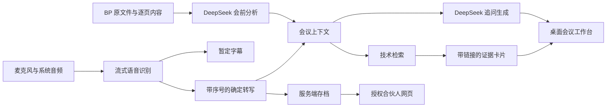

# VC 会议助手：首版产品与技术设计

日期：2026-11-16
状态：用户已批准实施，开发中。
工作名称：VC 会议助手（名称可后改）。

## 2026-11-16 实施中的用户修订（优先于下文原方案）

用户明确要求真实的实时效果，并将目标平台改为朋友的 Apple 芯片 Mac，要求打包交付；只配置 DeepSeek API，转写改用本地模型。

- 主交付变更为 macOS Apple Silicon arm64 应用测试包，系统音频方案以 macOS 14.2 及以上为目标。
- 默认使用本地 sherpa-onnx 流式中英文 Zipformer 模型，模型随包分发，不上传音频到语音云服务；腾讯云适配保留为可选项。
- 本地推理放入独立工作线程，持续返回暂定结果与端点确定结果。DeepSeek 调用不阻塞它。
- 应用内提供 DeepSeek 密钥配置入口，不要求朋友安装 Node.js 或手动编辑隐藏文件。
- 当前开发机为 Windows；跨平台打包、真实本地模型测试与 Mac 实机验证分别记录，不能互相替代。正式开发者签名/公证依赖 Apple 签名材料及 macOS 构建环境。
- 无法可靠实时补发的断线音频选择明确标记缺口并停止采音，恢复后由用户继续，避免积压使字幕越来越晚。

## 1. 已确认需求与本方案默认选择

用户已确认：用于 VC 与创业者的线上、线下会议；电脑端优先；会前上传 BP 等材料；会中实时录音转写、搜索相关技术内容、提示值得问的问题；调用 DeepSeek API；支持向其他合伙人同步。

以下是为首版收敛范围所作的默认选择，尚不代表用户已逐项确认：

- Windows 11 为首版实际验收平台，界面使用中文，转写兼顾中英文术语；保留跨平台结构，macOS 收音与安装包另行实机验收。
- 面向 VC 内部使用：创业者是参会者，首版不为创业者另建工作台。
- 采用电脑应用收音、服务端处理与存储、浏览器供合伙人查看的方式。
- 一个团队、多个项目；首版规模目标为同一场会议 1 名录音主持人、至多 5 名同时查看的合伙人。不是已验证的容量指标。
- 优先实现 PDF、PPTX；其他文档格式后续扩展。第一版文件限制为 30 MiB、100 页，超限明确提示。
- 真实 API 功能需要在本机配置服务凭据；凭据不写入代码、聊天、浏览器存储或安装包。

## 2. 产品目的与验收方式

帮助投资人在不打断谈话的情况下抓住关键问题，并让未参会的合伙人能追溯结论的依据。

首版的完整流程：创建项目 → 上传并审阅 BP 摘要 → 选择会议收音方式 → 开始转写 → 查看追问与证据 → 标记已问/已回答 → 结束会议 → 审阅纪要 → 授权合伙人访问。

成功必须同时满足：

1. 录到需要的声音，且音频中断可见、可恢复。
2. 追问基于实际对话或材料，已回答的问题不会持续刷屏。
3. 搜索结果有可打开的来源；没有证据时明确显示“待核实”。
4. 纪要能够回到原话和材料；AI 推断与创业者陈述明确区分。
5. 合伙人能在授权范围内查看会议和评论，撤销权限后立即失去服务端访问权限。

不以“成功调用模型”“模拟字幕滚动”代替上述验收。

## 3. 方案比较与选择依据

| 方式 | 适用性 | 代价与限制 |
| --- | --- | --- |
| 纯网页 | 上传文件、线下麦克风录音和协作交付快 | 收取线上会议系统音频受浏览器、操作系统和分享方式限制 |
| 桌面收音＋网页协作（推荐） | 同时覆盖线上、线下；合伙人无需安装桌面端 | 要处理系统音频权限、安装包与本地/远端服务连接 |
| 加入会议的机器人 | 可在支持的会议平台收取音轨与会议信息 | 依赖平台接口、权限与机器人接入规则，难同时覆盖线下 |

用户已选择“线上和线下都要，优先做电脑端”。据此，本设计推荐第二种；Electron、服务端技术与 Windows 优先验收是本方案的实现选择。

## 4. 首版页面与功能

### 4.1 项目与会前准备

- 项目列表显示公司/项目名称、最近会议、待核实问题数量。
- 项目中上传 BP，保存原文件及版本；替换材料不覆盖旧会议引用。
- 提取产品、客户、技术路线、关键指标、商业模式、融资需求，并生成不超过 10 个会前问题。
- 每项提取保留页码/幻灯片编号、原文片段；无法定位的内容标记“未定位”，不能伪造页码。
- 图表和扫描页需要识别；识别失败显示具体页并允许补充文字，不能显示为空白却宣称解析成功。
- 用户可编辑摘要、纠正术语和标记最关心的议题。BP 中的公司名、技术名词可形成转写术语表。

### 4.2 会议工作台

核心区域为实时转写、追问卡片、证据详情；BP 可打开至引用页。录音状态、音量、服务连接状态始终可见。

每张追问卡片包含：

- 建议问法，尽量是一句可直接说出口的话。
- 为什么现在值得问，以及验证什么信息。
- 触发它的会议原话或 BP 页码。
- 外部来源（如有）、检索时间与“已查资料/待核实”状态。
- 已问、已回答、稍后、忽略操作；支持手动补充问题。

默认仅突出 1–3 张当前问题；新问题进入候选列表，避免频繁移动用户正在看的卡片。用户标记已回答后，保留原问题及回答依据。

示例：对方说“准确率 95%”，可追问测试集、样本量、基线和客户场景表现。不能仅凭该数字判定技术成熟或数据造假。

### 4.3 合伙人协作

- 首版使用应用内账户、项目邀请和浏览器查看。邀请由用户复制给合伙人，不自动发邮件或其他消息。
- 项目角色：管理员可管理成员；编辑者可整理摘要和纪要；查看者可查看并评论，但不能修改转写。
- 接受邀请需要登录；邀请令牌一次性使用、有有效期，不能仅凭会议 ID 访问项目。
- 被邀请的合伙人可在会中看到确定转写、共享追问和公共评论。暂定转写不是可靠的存档记录。
- 私人笔记默认仅作者可见，只有作者明确转为共享后才同步；暂不提供创业者访问入口。
- 撤销成员时关闭其实时连接，并在每个后续请求检查权限。已被用户下载的文件无法从对方设备远程收回。

### 4.4 会后

- 停止采音，等待最后一段转写完成，再生成纪要草稿。
- 纪要包含项目摘要、主要陈述、讨论要点、已回答/未回答问题、潜在风险、待补材料、下一步负责人和日期（只有对话中出现或用户指定时填写）。
- 草稿由主持人审阅后发布给项目成员；实时共享范围与最终纪要发布相互独立。
- 支持导出 Markdown；保留回到会议时间点和材料页码的引用。无音频保留时仍可定位对应转写。

## 5. 收音与实时处理

### 5.1 两种模式

线下模式：采集选定麦克风，可选择会议麦克风。匿名说话人分组允许人工标注姓名或角色，不把声纹聚类当作身份识别。

线上模式：采集本机麦克风与系统播放音频。开始前分别显示两路音量，检查自己与远端参会者是否都能录到。系统回环可能包含其他应用声音，界面明确提示；首版不承诺只录某个会议窗口。建议佩戴耳机减少重复收音，扬声器模式需另测回声表现。

任何一种模式下都由用户主动开始录音，界面持续显示录音状态并支持立即暂停。开始前确认已告知参会者并取得适用的录音同意。

### 5.2 数据流

字幕和 AI 分析彼此独立。暂定结果可修订；确定句按提供方会话 ID、句子 ID 和本地序号去重后入库。仅确定句触发分析，并合并相邻内容。

追问快路径使用会前摘要、近期确定转写、滚动摘要和已问问题；证据路径按新技术主张触发联网检索。搜索慢、失败或达到额度时，字幕与本地上下文追问仍可运行，但不能显示为已经核实。

默认分析节奏由开发者根据实测调整，初始为约 10–15 秒合并一次有意义的新增内容；没有新信息时不重复调用。对同一技术问题缓存检索结果并标注检索时间；已过时的请求取消或丢弃，不覆盖后来的话题。

## 6. API 与技术选择

- 桌面：Electron＋React＋TypeScript。使用系统授权的麦克风和音频回环；安全隔离渲染进程，收音与文件访问只经最小 IPC 接口。
- 服务：Node.js／TypeScript＋Fastify，WebSocket 用于音频与实时事件；耗时分析从字幕处理链中分离。
- 持久化：单服务器 SQLite（WAL）与独立文件目录，适配首版团队规模；文件与数据库纳入同一备份策略。大规模和多实例部署不属于首版，届时可迁移 PostgreSQL／对象存储。
- 语音：优先腾讯云流式 ASR V2。保留供应商适配层；实际账户权限、识别质量、并发限制和成本需实测。
- 推理与检索：DeepSeek API，按当前官方支持配置模型。模型名在服务配置中可修改。
- BP：本地/服务端保留逐页索引与原件，DeepSeek 文件解析用于语义分析；不能假设可从其 Files API 下载解析文本。图文识别选择与分页定位由适配层完成。
- 网页：与桌面共享可复用界面，合作方只需打开部署后的服务地址。

截至 2026-11-16 核验的接口边界：

1. DeepSeek 已开放文件解析、联网搜索、URL 阅读等 API；支持带引用的搜索响应。
2. DeepSeek 自带 ASR 为整段文件转写，不支持连续流式识别，单次最多 120 秒/8 MiB，因此不作为会议实时字幕主链路。
3. 腾讯云流式 ASR 可返回暂定/确定句与匿名说话人编号；编号可能随后修订。
4. 桌面系统音频能力仍受操作系统、权限和 Electron 版本影响，必须进行真实设备收音测试。

这些是文档核验结果，不是本项目已完成的真实 API 或会议测试。

## 7. 本地运行、远程协作和凭据

同一套服务代码支持两种部署：

- 本机模式：桌面应用连接本机服务，默认仅监听 127.0.0.1，可验证个人会议全流程；其他电脑不能据此远程访问。
- 团队模式：桌面和合伙人浏览器连接同一个具备 HTTPS/WSS 的服务器，使用统一项目数据和权限。真正的远程协作验收必须在不同设备上进行。

首版不自动把本机会议公开到互联网，也不自动购买服务器。开发交付包含部署说明和服务器配置模板；上线地址、域名、云资源账户等是部署时需要的条件，本地开发不以此为前置条件。

DeepSeek 与 ASR 密钥由服务端环境变量或受保护的本机配置提供，只返回“已配置/不可用”状态。前端、日志、导出和报错不含密钥；管理员可设置单场会议调用上限。

开发时提供明确标记的演示模式，便于无密钥查看交互。演示模式与真实会议模式分离，绝不在 API 失败时悄悄用模拟结果替代。

## 8. 数据、证据与安全边界

主要实体：用户、项目、项目成员、材料版本、会议、转写段落、问题、来源、评论/私人笔记、纪要版本和操作事件。所有会议子资源必须关联项目并经服务端鉴权。

每条问题和纪要结论保存类型：创业者陈述、材料陈述、外部资料或 AI 推断；引用原文、时间戳、材料版本/页码、来源 URL 与检索时间。无法证实的事实保留待核实状态，不输出虚构置信百分比。

录音默认实时处理，不长期保留原音频；主持人可在开始前启用保存，界面展示保留状态。转写、材料和纪要保留至项目管理员删除。删除覆盖本服务文件、记录和提供方可删除的文件副本，备份按说明中的轮替周期清除；不宣称可控制第三方提供方内部日志的保留。

实时转写会发送至语音服务；用于分析的材料与转写会发送至 DeepSeek。公开技术检索只使用必要的技术问题，默认去除公司名、客户名单、未公开营收等信息；企业私有信息不得直接拼接到搜索查询。首版采用可检查的独立查询构建步骤，避免把整份 BP 与联网搜索混在一次无边界请求中。

BP、网页和转写均视为内容，不能通过其中的指令改变应用权限、读取其他项目、执行程序或泄露密钥。工具范围限于当前会议的数据读取与允许的检索。

## 9. 中断、重连和状态

- 麦克风拒绝授权、无系统音轨、设备被拔出：明确指出缺失哪一路，不显示“录音正常”。
- 断线：显示重连状态；客户端短暂缓存未确认音频（上限 60 秒），重连后按提供方允许的速率处理。超过上限或无法补发的区间标记“转写缺口”，不得静默丢失。
- 恢复：转写和协作事件具有递增序号，客户端重连后补取缺失数据，重复事件不重复入库。
- ASR 超时/限额：保留已有内容，提示字幕暂停；不能用模型生成内容填充转写缺口。
- DeepSeek/搜索不可用：继续转写，保留既有问题，显示具体功能暂不可用并支持重试。
- 结束会议：先停止采集，再冲刷尾段并确认转写状态；未完成的识别或分析明确记录在纪要草稿状态中。
- 应用异常退出：重开可恢复已经落盘的会议；未确认音频和数据是否可恢复应如实显示。

## 10. 验收与交付

开发验证与实机会分开报告：

| 场景 | 必须观察到的结果 |
| --- | --- |
| BP 准备 | 示例 PDF/PPTX 可处理，原文、页码和摘要能互相核对，扫描失败可见 |
| 线下面谈 | 实际麦克风录入两人对话，产生真实转写，可纠正说话人 |
| 线上会议 | 至少一个目标会议软件的双向对话被收取；分别验证耳机、静音及设备切换 |
| 追问 | 针对测试会议中的新主张产生相关问题，已回答问题不持续重复；触发原话可追溯 |
| 技术检索 | 使用真实 API 返回可打开的资料链接；失败时显示失败，无伪造来源 |
| 协作 | 两台设备用不同账户查看同一场会议，评论可同步；无权账户被拒绝，撤销后连接关闭 |
| 稳定性 | 60 分钟会议、一次网络中断和一次输入设备切换，能解释所有缺口，无静默覆盖 |
| 纪要 | 原话、外部资料和推断分开；发布前可编辑，导出可读 |

初始性能目标：正常网络下，暂定字幕延迟 P95 约 3 秒以内；确定句后无需检索的建议 P95 约 10 秒以内；检索建议 P95 约 20 秒以内。指标从捕获/确定句事件到界面显示计时，并记录样本数；这是工程目标，不能在实测前宣称达标。

交付包括源代码、运行说明、环境配置模板、明确标记的演示数据、Windows 开发运行入口和可构建安装包配置。真实安装包产出、签名、真实 API、双设备协作及长时间收音各自注明是否已完成，不能相互替代。

首版不包含：会议机器人、CRM 全套功能、移动端 App、自动投资评级或投决、跨团队 SaaS 计费、所有会议软件/所有系统的兼容承诺。

## 11. 后续实施顺序

1. 建立项目/材料/会议的数据与权限基础，做出可操作的会前和会议工作台。
2. 接入桌面收音、真实流式转写及重连，优先验证线上两路声音。
3. 接入 DeepSeek 会前分析、追问、独立技术检索与引用。
4. 接入合伙人实时查看、权限撤销、纪要审阅与导出。
5. 执行真实设备、真实 API、不同设备协作和长会议验证，整理缺口。

页面视觉、具体组件库、数据库字段、文件解析库、测试夹具与内部模块划分由开发者决定；不需要为这些常规选择再次询问用户。

## 12. 官方依据

- DeepSeek 功能发布：https://api-docs.deepseek.com/news/news261113/
- DeepSeek Web Tools：https://api-docs.deepseek.com/guides/web_tools/
- DeepSeek Files API：https://api-docs.deepseek.com/guides/files_api/
- DeepSeek ASR：https://api-docs.deepseek.com/guides/asr/
- 腾讯云流式 ASR：https://cloud.tencent.com/document/product/1093/131127
- Electron 桌面采集：https://www.electronjs.org/docs/latest/api/desktop-capturer/
- 浏览器收音限制：https://developer.mozilla.org/en-US/docs/Web/API/MediaDevices/getDisplayMedia
